<p align="center">
  
</p>

<h1 align="center">GitSight</h1>

<p align="center">
  Contrasta los commits, la bitácora de prompts y la declaración de autoría de un repositorio,<br>
  y muestra cada hallazgo con la evidencia a un clic.
</p>

<p align="center">
  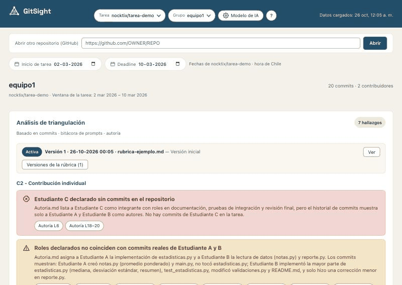
</p>

## Contenido

1. [Para qué sirve](#1-para-qué-sirve)
2. [Requisitos](#2-requisitos)
3. [Instalación y arranque](#3-instalación-y-arranque)
4. [Configurar el modelo de IA](#4-configurar-el-modelo-de-ia)
5. [Prueba rápida con el repositorio de demostración](#5-prueba-rápida-con-el-repositorio-de-demostración)
6. [Cómo se usa, paso a paso](#6-cómo-se-usa-paso-a-paso)
7. [Formato de la bitácora y de la autoría](#7-formato-de-la-bitácora-y-de-la-autoría)
8. [Privacidad](#8-privacidad)
9. [Solución de problemas](#9-solución-de-problemas)
10. [Contexto académico](#10-contexto-académico)
11. [Licencia](#11-licencia)

Si vas a modificar el código, mira la [guía de desarrollo](docs/desarrollo.md).

## 1. Para qué sirve

En cursos de programación donde se permite usar IA generativa siempre que se documente, cada grupo
entrega un repositorio de Git con tres cosas que deberían contar la misma historia:

- los **commits**: quién cambió qué y cuándo;
- la **bitácora de prompts** (`bitacora_de_prompts.md`): qué le pidieron a la IA y qué hicieron con la respuesta;
- la **declaración de autoría** (`Autoria.md`): quién hizo cada parte del trabajo.

GitSight descarga el repositorio, **contrasta esas tres fuentes** (y la rúbrica de la tarea) y entrega
una lista de hallazgos organizada por criterio: qué coincide, qué no coincide y qué conviene revisar con
más detalle. Cada hallazgo trae **chips de evidencia** (un commit, unas líneas de la bitácora o de la
autoría) que se abren con un clic, para que verifiques los hechos por ti mismo.

**Lo que GitSight no hace:** no pone notas, no emite veredictos y no juzga la intención de los
estudiantes. Muestra hechos observables y su evidencia; la evaluación sigue siendo tuya. Cuando un
hallazgo no tiene evidencia que lo respalde, lo dice.

## 2. Requisitos

| Qué | Versión | Para qué |
|---|---|---|
| [Python](https://www.python.org/downloads/) | 3.12 o superior | el servidor local (backend) |
| [Node.js](https://nodejs.org/) | 22.18 o superior (versión LTS) | la interfaz (frontend) |
| [Git](https://git-scm.com/downloads) | cualquiera reciente | descargar los repositorios de los grupos |
| Un navegador moderno | Chrome, Edge, Firefox o Safari | usar la aplicación |
| Una cuenta con un proveedor de IA | o [Ollama](https://ollama.com/download) instalado | el análisis (ver [sección 4](#4-configurar-el-modelo-de-ia)) |

Funciona en macOS, Linux y Windows. Necesitas conexión a internet para descargar los repositorios y
para llamar al proveedor de IA (con Ollama, el análisis no sale de tu computador).

## 3. Instalación y arranque

### Descargar GitSight

Con Git:

```bash
git clone https://github.com/nocktix/gitsight.git
cd gitsight
```

O sin Git: en la página del repositorio, **Code → Download ZIP**, descomprime y entra a la carpeta.

### Arranque con un solo comando

**macOS y Linux**

```bash
bash start.sh
```

**Windows**: haz doble clic en `start.bat` (o, en PowerShell, `.\start.ps1`).

El script comprueba que tengas Python, Node.js y Git; **la primera vez** crea el entorno de Python e
instala las dependencias (puede tardar unos minutos); revisa que los puertos 8000 y 5173 estén libres
(si no lo están, te dice qué programa los usa y te pregunta si lo cierras); arranca el backend y el
frontend, y abre GitSight en tu navegador en <http://localhost:5173>. Para cerrar todo, presiona
**Ctrl+C** en la ventana del script. Los registros quedan en la carpeta `.tid-logs/`.

> Los scripts se probaron en macOS. El de Linux comparte el mismo código; el de Windows
> (`start.ps1` / `start.bat`) está escrito pero todavía no se ha probado en un equipo Windows. Si
> algo falla, usa los pasos manuales de más abajo y cuéntanos qué pasó.

Opciones: `--no-browser` (no abre el navegador) e `--install-only` (solo instala las dependencias).
En Windows: `-NoBrowser` e `-InstallOnly`.

### Pasos manuales

Úsalos si prefieres controlar cada paso o si el script no funciona en tu equipo. Abre **dos**
terminales dentro de la carpeta de GitSight.

**Terminal 1: backend** (en Windows, reemplaza `source .venv/bin/activate` por `.venv\Scripts\activate`)

```bash
cd backend
python3 -m venv .venv
source .venv/bin/activate
pip install -r requirements.txt
uvicorn app.main:app --host 127.0.0.1 --port 8000
```

**Terminal 2: frontend**

```bash
cd frontend
npm install
npm run dev -- --port 5173 --strictPort
```

Abre <http://localhost:5173>.

## 4. Configurar el modelo de IA

GitSight usa **tu propia cuenta** de un proveedor de IA. Se configura una vez desde la aplicación:
botón **Modelo de IA** (engranaje) de la barra superior.

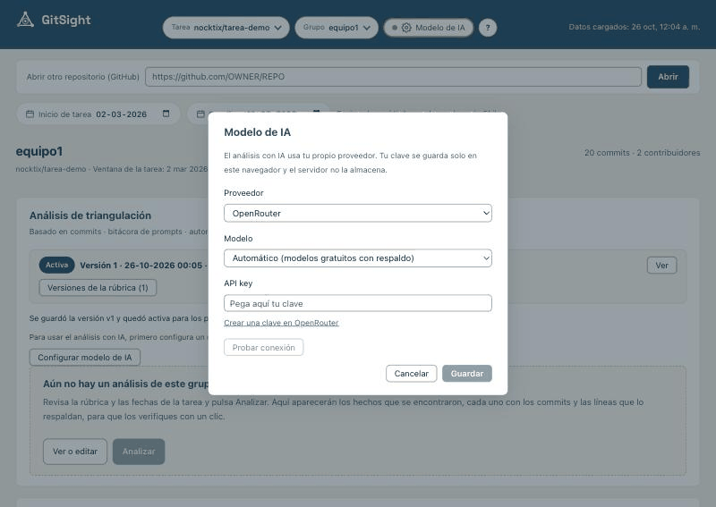

1. Elige el **proveedor**.
2. Elige o escribe el **modelo** (cada proveedor muestra un ejemplo).
3. Pega tu **API key** (la clave que te da el proveedor; ver la tabla).
4. Pulsa **Probar conexión**. Si funciona, **Guardar**.

| Proveedor | Dónde crear la clave | Ejemplo de modelo |
|---|---|---|
| OpenRouter | [openrouter.ai/keys](https://openrouter.ai/keys) | «Automático» (modelos gratuitos con respaldo) |
| OpenAI | [platform.openai.com/api-keys](https://platform.openai.com/api-keys) | `gpt-4o-mini` |
| Anthropic | [platform.claude.com/settings/keys](https://platform.claude.com/settings/keys) | `claude-sonnet-4-5` |
| Google Gemini | [aistudio.google.com/apikey](https://aistudio.google.com/apikey) | `gemini-2.5-flash` |
| Groq | [console.groq.com/keys](https://console.groq.com/keys) | `llama-3.3-70b-versatile` |
| DeepSeek | [platform.deepseek.com/api_keys](https://platform.deepseek.com/api_keys) | `deepseek-chat` |
| Ollama (local) | no necesita clave | `llama3.1` |
| Otro (compatible con OpenAI) | la de tu servicio | el nombre que use tu servicio |

Los nombres de modelo cambian con el tiempo: si el proveedor no reconoce el que usas, revisa su lista de
modelos y escribe uno vigente. Las páginas de clave piden iniciar sesión.

**Sobre tu clave:** se guarda **solo en tu navegador** (no en un archivo ni en el servidor de GitSight).
Viaja con cada análisis a tu servidor local, que la reenvía a tu proveedor y no la guarda ni la escribe en
ningún registro. Si usas un computador compartido, bórrala con el botón **Borrar** de la ventana del modelo.

**Modelos gratuitos de OpenRouter.** El modo «Automático» prueba una lista de modelos gratuitos y pasa al
siguiente si uno no responde. Sirve para probar, pero puede ser lento o fallar en horas de mucha demanda.

**Ollama (todo en tu computador).** Si no quieres enviar nada a internet:

1. Instala [Ollama](https://ollama.com/download) y descarga un modelo, por ejemplo `ollama pull llama3.1`.
2. En GitSight elige **Ollama (local)** y el nombre del modelo. No hace falta clave.

Los modelos locales pequeños suelen razonar peor y a veces no responden en el formato esperado
(ver [solución de problemas](#9-solución-de-problemas)).

## 5. Prueba rápida con el repositorio de demostración

Hay un repositorio ficticio listo para probar, con dos estudiantes inventados («Estudiante A» y
«Estudiante B»), 20 commits entre el 2 y el 12 de marzo de 2026, una bitácora y una declaración de autoría:
<https://github.com/nocktix/tarea-demo-equipo1>

1. Abre GitSight y pega esa dirección en la pantalla de inicio. Confirma la tarea `nocktix/tarea-demo`
   (el grupo es `equipo1`).
2. Pon las fechas: inicio **02-03-2026** y entrega **10-03-2026**.
3. Sube la rúbrica de ejemplo [`docs/rubrica-ejemplo.md`](docs/rubrica-ejemplo.md) (botón **Agregar rúbrica**).
   Para probar las versiones, [`docs/rubrica-ejemplo-v2.md`](docs/rubrica-ejemplo-v2.md) es una segunda versión.
4. [Configura el modelo de IA](#4-configurar-el-modelo-de-ia) y pulsa **Analizar**.

Deberías ver 20 commits, 3 de ellos fuera de plazo (11 y 12 de marzo), y hallazgos como estos, cada uno con
su evidencia: la bitácora se agregó completa en un solo commit; hay un integrante declarado sin commits
(«Estudiante C»); `estadisticas.py` se declara de «Estudiante A», pero sus commits son de «Estudiante B»; y
una entrada de la bitácora menciona un archivo que no existe. Los hallazgos exactos y su redacción varían
según el modelo que uses.

## 6. Cómo se usa, paso a paso

### 6.1 Abrir un repositorio

Pega la dirección de GitHub del repositorio de un grupo (por ejemplo,
`https://github.com/ORGANIZACION/tarea01-equipo1`) y pulsa **Cargar repositorio**.

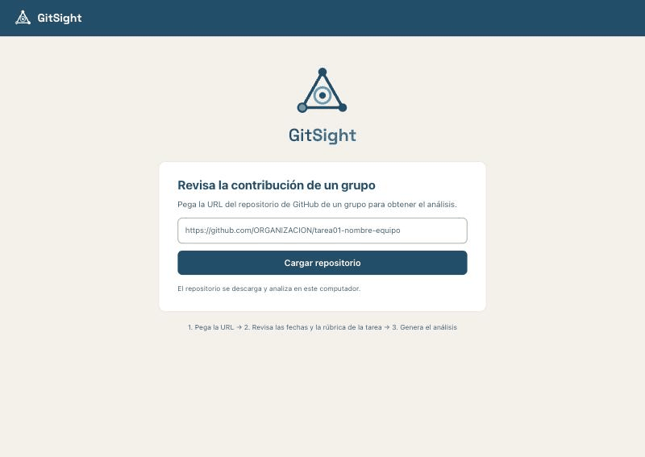

GitSight lo descarga a tu computador y deduce la **tarea** y el **grupo** a partir del nombre: lo que va
hasta el último guion es la tarea y lo que sigue es el grupo. Si no está seguro, te pide confirmar:

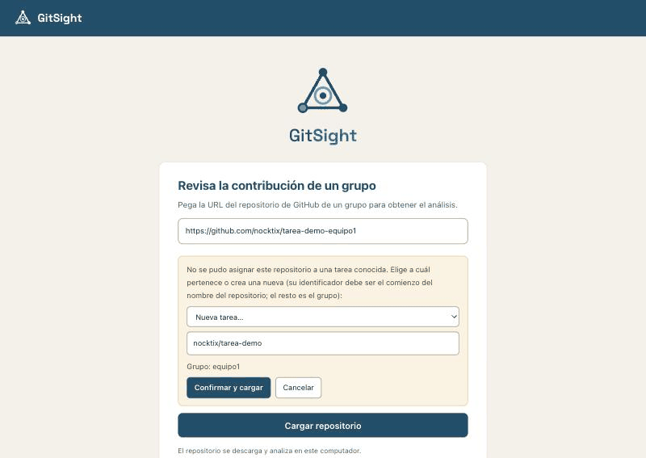

Después puedes abrir otros grupos de la misma tarea desde la barra superior (selectores **Tarea** y
**Grupo**) o pegando otra dirección en **Abrir otro repositorio**. Si el repositorio es privado, ver
[solución de problemas](#9-solución-de-problemas).

### 6.2 Fechas de la tarea

Indica el **inicio** y la **entrega** (hora de Chile; la entrega vence a las 23:59 de ese día). Se guardan
por tarea y las comparten todos sus grupos. Con ellas, GitSight marca los commits posteriores a la
entrega. Sin fecha de entrega no puede detectarlos.

### 6.3 Calendario de actividad y vista por horas

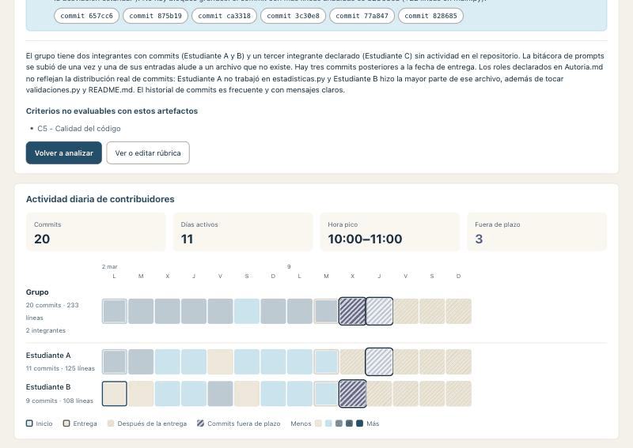

- Cada cuadrado es un día; mientras más oscuro, más commits. Hay una fila por integrante y una del grupo.
- **Inicio** y **Entrega** de la tarea se marcan con anillos de colores. Los días **después de la entrega**
  llevan un rayado gris y, si hubo commits, un **rayado violeta**: así se distinguen sin depender del color.
- Al pasar el mouse sobre un hallazgo, el calendario **resalta los commits que cita** (en la imagen, los
  tres commits fuera de plazo) y atenúa el resto.
- Haz clic en un día para ver sus commits **por hora**. Cada triángulo es un commit (más grande, más
  líneas); los de fuera de plazo son violetas y con contorno.

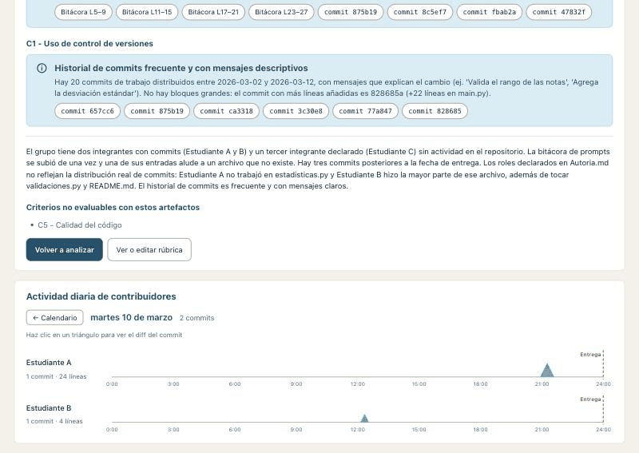

Al hacer clic en un triángulo se abre el panel del commit con sus cambios y, si quieres, un **resumen con
IA** de ese commit.

### 6.4 Analizar

Con la rúbrica cargada y el modelo configurado, pulsa **Analizar**. GitSight envía al modelo los commits,
la bitácora, la autoría y la rúbrica activa, y recibe una lista de hallazgos. Puede tardar un minuto o más
según el modelo.

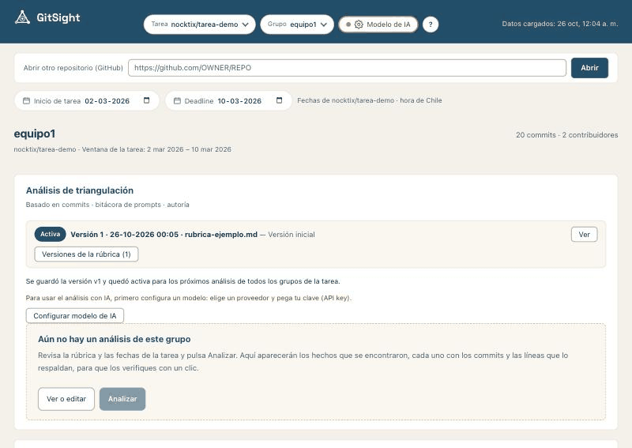

### 6.5 Hallazgos y chips de evidencia

Cada hallazgo tiene un tipo, con su propio ícono además del color:

- **Información** (círculo): un hecho relevante, sin conflicto entre las fuentes.
- **Discrepancia** (triángulo): una diferencia puntual entre lo declarado y lo observado.
- **Alerta** (octágono): un patrón que conviene revisar primero (commits posteriores a la entrega, una
  bitácora agregada en un solo commit, un integrante declarado sin commits o con commits sin declarar…).

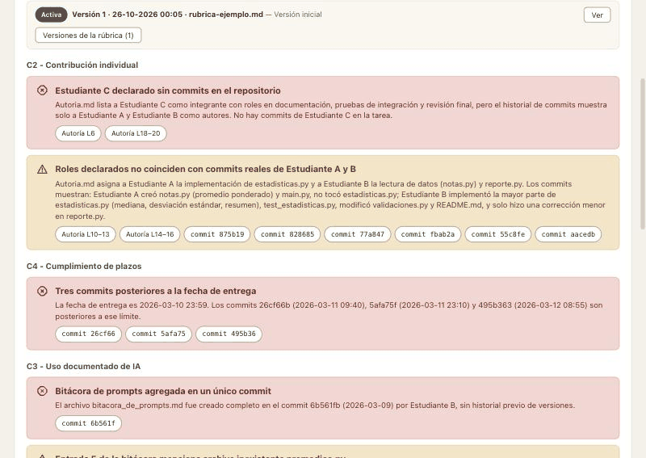

Los **chips** bajo cada hallazgo son su evidencia: `commit 875b19`, `Bitácora L5–9`, `Autoría L10–13`. Al
hacer clic en un chip de commit se abre ese commit (y el calendario salta a su día); al hacer clic en un
chip de bitácora o autoría se abre el archivo con esas líneas resaltadas:

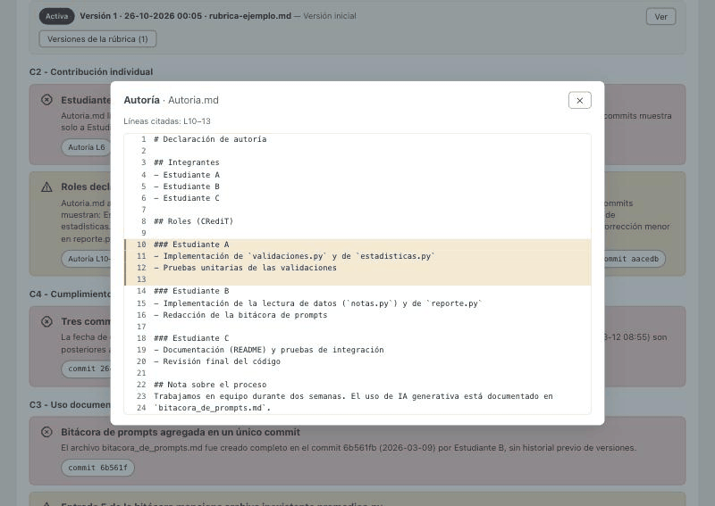

Un hallazgo sin evidencia válida se marca como «sin evidencia vinculada». GitSight descarta toda
referencia que no exista de verdad en el repositorio.

### 6.6 Rúbrica y sus versiones

La rúbrica es **por tarea**: la usan todos los grupos. Puedes subir un archivo (`.pdf`, `.docx`, `.md` o
`.txt`) o pegar el texto, y escribir una nota (botón **Ver o editar rúbrica** / **Agregar rúbrica**).

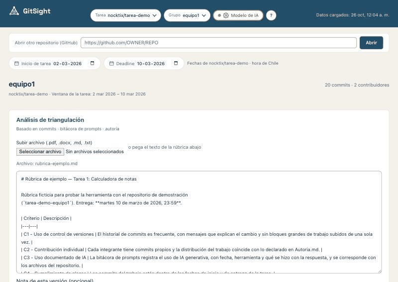

**Nunca se sobrescribe**: cada subida crea una versión nueva y las anteriores se conservan.

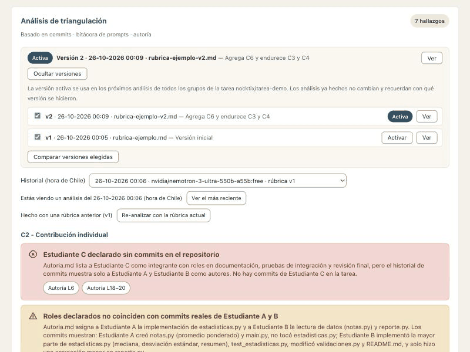

- La versión **activa** es la que usan los análisis nuevos de **todos los grupos de la tarea**. Puedes
  activar una versión anterior (se te avisa el alcance antes de confirmar).
- **Ver** muestra el texto de una versión. **Comparar** muestra dos versiones lado a lado, con los criterios
  agregados, quitados y modificados (los criterios se reconocen si están numerados, por ejemplo
  `C1 - Título`).
- «Solo guardar como versión nueva» sube una versión sin volver a analizar nada.

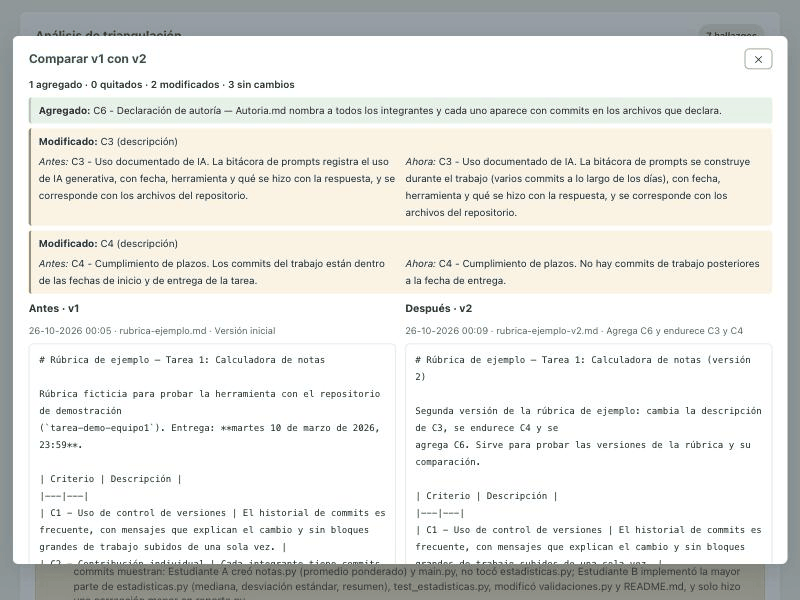

### 6.7 Historial de análisis

Cada análisis queda guardado, con su fecha, su modelo y la versión de la rúbrica con que se hizo. El
selector **Historial** permite volver a los anteriores. Si un análisis se hizo con una rúbrica distinta de
la activa, aparece un aviso y el botón **Re-analizar con la rúbrica actual**; GitSight nunca re-analiza por
su cuenta.

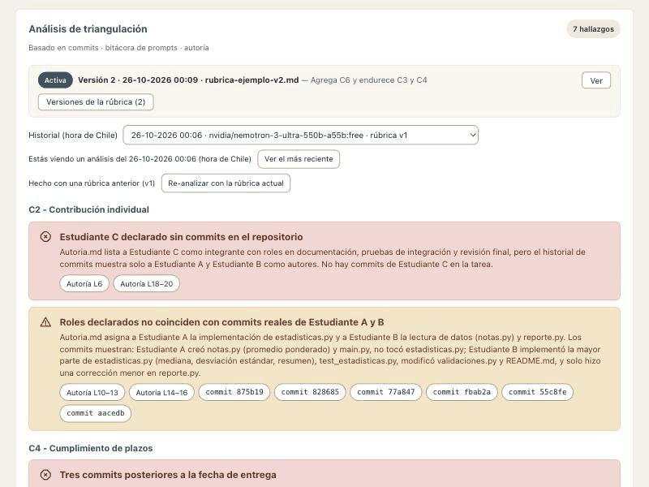

### 6.8 Recorrido guiado

La primera vez que abres un repositorio, un recorrido de siete pasos explica cada zona. Puedes repetirlo
cuando quieras con el botón **?** de la barra superior.

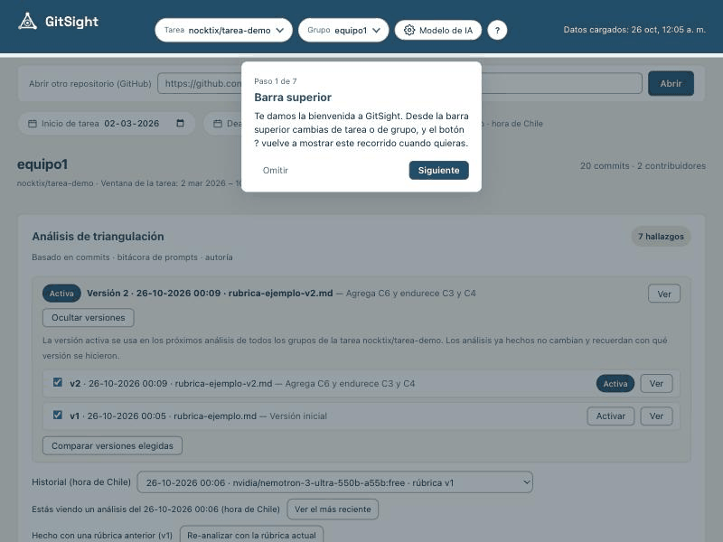

## 7. Formato de la bitácora y de la autoría

GitSight busca los dos archivos en la **raíz del repositorio**. Son texto libre: no hace falta un formato
estricto, pero mientras más claros, mejores hallazgos.

**`bitacora_de_prompts.md`**: una entrada por uso de IA, con fecha, herramienta, lo que se pidió y qué se
hizo con la respuesta.

```markdown
# Bitácora de prompts

## Entrada 1
- **Fecha:** 2026-03-03
- **Herramienta:** ChatGPT
- **Prompt:** ¿Cómo calculo un promedio ponderado en Python con dos listas?
- **Qué hicimos con la respuesta:** Entendimos la idea del `zip` y escribimos la función nosotros.
```

**`Autoria.md`**: quiénes son los integrantes y qué hizo cada uno (por ejemplo, con los roles CRediT).

```markdown
# Declaración de autoría

## Integrantes
- Estudiante A
- Estudiante B

## Roles
### Estudiante A
- Implementación de `validaciones.py`
### Estudiante B
- Lectura de datos y reporte
```

**Tolerancia a los nombres.** Los estudiantes se equivocan al escribir: GitSight busca los archivos sin
distinguir mayúsculas ni tildes y acepta nombres parecidos (`bitacora_de_propts.md`, `Bitacora.md`,
`autoría.md`…). Si el archivo tiene otro nombre que el esperado, lo usa igual y lo informa como un hallazgo:
«Se encontró como `bitacora_de_propts.md` (nombre distinto al esperado)». Si hay varios candidatos, usa el
más parecido y menciona los otros. Solo dice que un archivo «falta» cuando de verdad no hay nada parecido.

## 8. Privacidad

**Se queda en tu computador:**

- los repositorios descargados (carpeta `~/.tid-cache/repos`);
- la base de datos con tareas, fechas, rúbricas, versiones y análisis (`backend/data/tid.db`, con
  respaldos automáticos `tid.db.bak-…` al actualizar);
- tu configuración del modelo y tu API key (en el almacenamiento de tu navegador);
- los registros de arranque (`.tid-logs/`).

Nada de esto se sube a GitHub: está excluido por `.gitignore`. GitSight no envía telemetría ni usa
servicios externos para sus tipografías o estadísticas.

**Se envía a tu proveedor de IA** (por eso conviene revisar la política de tu institución sobre datos
de estudiantes antes de usar un servicio externo):

- en cada **análisis**: el texto de la rúbrica activa, el listado de commits (hash, autor, fecha, mensaje y
  archivos modificados), y el contenido de la bitácora y de la autoría;
- en cada **resumen de un commit**: el mensaje y los cambios (diff) de ese commit;
- tu API key, solo como credencial de la llamada.

El código fuente de los estudiantes no se envía, salvo los cambios del commit que pidas resumir. Con
**Ollama** nada de esto sale de tu equipo.

## 9. Solución de problemas

**«El puerto 8000 (o 5173) ya está en uso».** Hay otro programa (a veces una ejecución anterior de GitSight)
usando ese puerto. El script te dice cuál y te pregunta si lo cierras. Si prefieres hacerlo tú, cierra ese
programa y vuelve a ejecutar.

**`permission denied` al ejecutar `./start.sh`.** Usa `bash start.sh` o dale permiso con `chmod +x start.sh`.

**En Windows no se abre el script o dice que la ejecución está deshabilitada.** Usa `start.bat` (ya evita
esa restricción) o ejecuta `powershell -ExecutionPolicy Bypass -File start.ps1`.

**«Falta Python 3.12» o «Tu Node.js es…».** Instala la versión que pide el mensaje (ver
[requisitos](#2-requisitos)) y vuelve a ejecutar. Si ya la tienes instalada, cierra y abre la terminal.

**«La API key no es válida o no tiene permiso».** La clave está mal copiada, venció o pertenece a otro
proveedor. Crea una nueva en la página del proveedor, pégala en **Modelo de IA** y usa **Probar conexión**.

**«No queda crédito o se alcanzó el límite de uso».** Tu cuenta no tiene saldo o llegó a su límite. Recarga
saldo, espera un momento o prueba con otro modelo o proveedor.

**«El proveedor no reconoce el modelo».** Revisa que el nombre esté bien escrito y que siga vigente en el
proveedor, o elige otro.

**«El modelo no respondió en el formato esperado».** GitSight reintenta una vez pidiendo un JSON puro. Si
vuelve a fallar, prueba de nuevo o con otro modelo: los modelos pequeños o locales a veces no logran
responder en ese formato.

**El repositorio es privado o no se puede descargar.** GitSight descarga con `git clone` desde tu
computador, así que funciona con los repositorios que tú puedas descargar: prueba en una terminal
`git clone https://github.com/ORGANIZACION/REPO.git`. Si te pide usuario y contraseña, configura primero
el acceso a GitHub en tu equipo (GitHub Desktop, el administrador de credenciales de Git o un token
personal) hasta que el `git clone` funcione, y vuelve a intentarlo. La descarga tiene un límite de 60
segundos: en repositorios muy grandes o con mala conexión puede fallar.

**«No se pudo conectar con el backend».** El servidor local no está corriendo: vuelve a ejecutar el
script de arranque y no cierres su ventana.

**Dice que falta la bitácora o la autoría, pero el archivo existe.** Debe estar en la **raíz** del
repositorio (no dentro de una carpeta) y llamarse de forma parecida a `bitacora_de_prompts.md` o
`Autoria.md` (ver [sección 7](#7-formato-de-la-bitácora-y-de-la-autoría)).

**Los profesores o ayudantes aparecen como si fueran estudiantes.** Indícale a GitSight qué cuentas ignorar
(ver el recuadro de abajo).

**Quiero empezar de cero.** Cierra GitSight y borra la carpeta `backend/data/` (tareas, rúbricas y
análisis) y, si quieres, `~/.tid-cache/` (repositorios descargados).

### Excluir las cuentas de profesores y ayudantes

A veces profesores y ayudantes hacen commits en los repositorios de los grupos (por ejemplo, para subir el
informe de evaluación). Esos commits no son del grupo y distorsionan el calendario y el análisis. Para
excluirlos:

1. Copia el archivo `backend/.env.example` con el nombre `backend/.env` (si todavía no existe).
2. Abre `backend/.env` con un editor de texto y agrega una línea con los nombres, separados por comas,
   **tal como aparecen como autor de los commits** (los ves en el calendario o con `git log`):

   ```
   TID_EXCLUDED_AUTHORS=Profesora Ejemplo,ayudante-uno
   ```

3. Cierra GitSight (Ctrl+C) y vuelve a abrirlo.

No importan las mayúsculas, y el bot `github-classroom[bot]` siempre se excluye solo. Cada persona puede
aparecer con más de un nombre (por ejemplo, su nombre real y su usuario de GitHub): agrega los dos.

## 10. Contexto académico

GitSight nace en el **Proyecto de Investigación Dirigida (TID)** de la **Universidad Adolfo Ibáñez**.

- **Autoría:** _[completar: nombres de las personas autoras]_
- **Profesor guía:** _[completar: nombre del profesor o profesora guía]_
- **Cómo citar:** _[completar: formato de cita; por ejemplo, Apellido, N. (año). GitSight [software]. Universidad Adolfo Ibáñez. https://github.com/nocktix/gitsight]_

## 11. Licencia

_[Pendiente: elegir la licencia del proyecto y agregar el archivo `LICENSE`.]_
